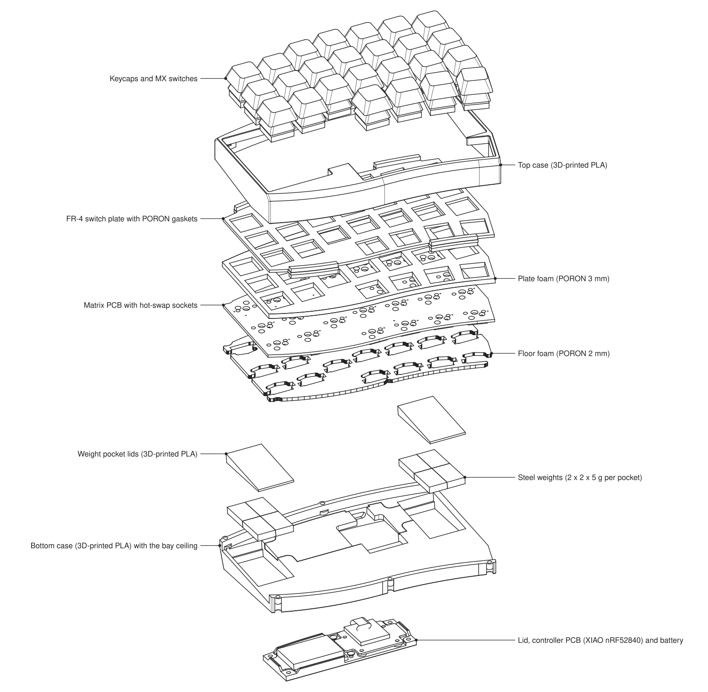

# DIY Keyboard "Opto" ⌨

A split wireless keyboard powered by the XIAO nRF52840 and ZMK (25 keys and 7 columns per hand, MX hot-swap, gasket mount).
The case is designed in [build123d](https://github.com/gumyr/build123d) and the PCBs in KiCad 10.



- The current version is v0.2.0. The left half is assembled and working. The right-hand case is the left one mirrored.
  Design notes and the parts list are in [docs/v0.2.0.md](docs/v0.2.0.md) (in Japanese).
- v0.1.0 (a FreeCAD case and wired PCBs) is available at the `v0.1.0` tag.
- The firmware lives in [hhiroshell/zmk-config](https://github.com/hhiroshell/zmk-config).
- Opto draws heavily on foostan's [Cornelius](https://github.com/foostan/corneliuskbd), and the exploded view above follows
  the style of the one in its README.

## Repository layout

| Directory | Contents |
|---|---|
| `case/` | 3D models of the case and related parts (build123d, a uv project): top case, bottom case, lid and controller bay, palm rest, and soldering jigs. Also generates the foam and gasket cut files and the PCB and plate outlines |
| `pcbs/` | KiCad projects: `matrix-left` and `matrix-right` (matrix PCBs), `controller` (controller PCB), `plate` (FR-4 switch plate), `root` (schematic of the whole keyboard) |
| `plate/` | Switch plate DXFs, the reference for the case outline. `plate_left.dxf` is the one in use |
| `layout/` | Key layout (Keyboard Layout Editor JSON) |
| `lib/` | KiCad footprint for the XIAO nRF52840 |
| `scripts/` | KiCad scripts (part placement, outlines, silkscreen, JLCPCB order files) and a script that syncs the Bambu Studio presets |
| `print/bambu/` | Bambu Studio presets (A1, 0.2 mm nozzle) |
| `docs/` | Design notes and images |

## Building the case models

Requires [uv](https://docs.astral.sh/uv/) and KiCad (`kicad-cli` and a `/usr/bin/python3` that can import `pcbnew`).

```bash
cd case
./build.sh                          # clear out/ and regenerate everything
uv run python top.py --show         # build one part and show it in OCP CAD Viewer
uv run python exploded.py           # regenerate docs/images/exploded-l.svg
```

- `case/out/print/`: parts to print (STEP / STL / 3MF). The cases, the lid, the bay ceiling, and the palm rest are written for
  the left hand (`-l`) and, mirrored, for the right hand (`-r`). The weight pocket lid (`weight-lid`) is one part for all four
  pockets; print four.
- `case/out/order/`: files to order with (the foam and gasket SVGs for Yushakobo's laser cutting service) and the outlines
  to load into KiCad's Edge.Cuts.

The foam cut files (`foam.py`) need Yushakobo's template `Laser_Poron_template.svg`. It isn't included in this repository;
download it from the link on the [design rules page](https://yushakobo.jp/lasercut/) and put it in `case/vendor/`.
